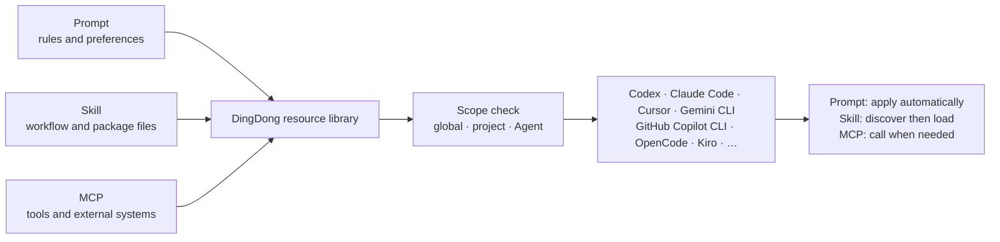

<p align="right">
  <strong>English</strong> · <a href="README.zh.md">简体中文</a>
</p>

<p align="center">
  
</p>

<h1 align="center">DingDong</h1>

<p align="center">
  <a href="https://github.com/JevonsCode/DingDongCodexPet">DingDong Codex Pet · mascot project</a>
</p>


<p align="center">
  <strong>Organize copied content and reuse it<br>Manage Prompts, Skills, and MCP in one place<br>A shared inbox for connected Agent events, with a sound you choose</strong>
</p>

DingDong is a free, open-source desktop companion for content work and local
Agents. Classify, search, preview, and reuse copied text, images, and files;
maintain Prompts, Skills, and MCP connections in one place; and review events
from connected Agents with the notification sound you choose. Selected content
and important reminders can also reach a trusted phone through the mobile PWA.

## Design principles

- **Quiet until needed.** DingDong lives in the menu bar or tray, opens with a
  shortcut, and rings only when an Agent finishes, gets stuck, or needs you.
- **Local first.** Clipboard history, resources, and Token counts stay on this
  computer. Agents can't read clipboard content until you allow it, and the
  relay stores nothing.
- **Show before writing.** Connecting, updating, or removing an Agent lists the
  exact configuration changes first. Unrelated settings are left alone, and
  plugins install only when you choose them.
- **Keep it once, deliver it when needed.** Each Prompt, Skill, and MCP server
  is kept once. Prompts arrive at task start, Skills load when they match, and
  MCP tools run only when called.
- **Honest numbers.** Unknown stays unknown, partial totals are marked `≥`, and
  a `*` records that something was used, not that it succeeded.
- **Keyboard first.** Every view, list, and filter works from the keyboard.

**DingDong 1.11.2 (build 85)** keeps new notification borders colored during the current visit and historical notification borders gray.

> **AI+** selects Prompts, Skills and MCP resources for an Agent’s current task.
> Configure a model once; resource selection runs only when an Agent requests it.
> Internal model Token usage is tracked separately.

See the [AI+ setup and privacy boundaries](docs/product/ai-companion.md) or browse the [user guides](docs/product/README.md).

Clipboard history loads 50 records at a time in both the quick panel and resource
manager. Search and filters cover the complete saved history. The quick panel
shows 21 recent Agents by default; change this under **Settings → Quick panel Agent count**. See [clipboard history](docs/product/clipboard-history.md)
and [reminders and recent Agents](docs/product/reminders.md).

At the end of a supported Agent's final reply, DingDong can add a compact
resource receipt: active Prompts, matching Skills, and available MCP connections
stay visible. A `*` marks a Skill loaded or an MCP called during that task.

## What DingDong manages

| Area | What you get |
| --- | --- |
| Clipboard content | Search and classify text, links, images, files, paths, and commands; groups, matching rules, pin saved items, preview, system open, copy, paste, share, and QR Code |
| Prompt | Full instructions delivered automatically when enabled scope rules match the current task |
| Skill | Complete packages with `SKILL.md`, scripts, references, and assets; on-demand loading, local version history, comparison and restoration |
| MCP | One managed server configuration synchronized into matching Agent clients while unrelated configuration is preserved |
| Agent activity | Local completion, blocker, and decision alerts with unread state, repeat counts, history, and a configurable sound |
| Agent reply footer | A compact final-line receipt for active Prompts, matching Skills, and available MCP connections; `*` marks a loaded Skill or called MCP |
| Local Token history | Daily history and heatmap for supported Codex, Claude Code, and Pi sources; filter by date and source, inspect counts and export CSV |
| AI+ | On-demand Prompt, Skill and MCP selection for Agents, with separate internal Token accounting |
| Connected devices | Pair phones or computers, share Clipboard items and files explicitly, opt into automatic computer sync, and choose direct LAN or encrypted service transport |

Clipboard and resource data stay on this computer by default. The lightweight
connection relay stores no clipboard or file content.

## Clipboard content you can find and reuse

Keep useful snippets, links, screenshots, and file references within reach.
Use content classifications and groups to narrow the view, search for a record,
preview it before reuse, and pin saved items you return to often. Copy or paste
an item back into your editor, open a file in its system application, or share
only the item you choose with a trusted device.

Clipboard monitoring starts off. Records stay local by default, and Agent
access to their content is a separate setting that also starts off. Copied
files and images can remain references to their original local paths;
screenshots without a source path use managed local storage and follow retention.

## A shared inbox for connected Agent events

Codex already has completion notifications. DingDong gives events from connected
Agents one place to review, with unread state, history, and preferences for which
events should notify you and which sound they use. Completion, blockers, and
requests for a decision stay distinguishable. The client's own notifications
are not automatically replaced; choose your preferred setup in each client.

In **Settings → Notifications**, control completion and needs-input reminders
separately, or add named reminders with their own color, sound, tray style and
phone setting. Agents can select one by `reminderId`. Custom sounds support
PCM WAV files up to 15 seconds and 5 MiB. A saved condition describes when an
Agent should notify; it does not start a monitor. See [Agent reminders](docs/product/agent-reminders.md).

## Local daily Token history

Open **Resource Manager → Token history** to see a
daily heatmap, filter by year or source, and inspect a day's usage. Supported
sources are **Codex, Claude Code, and Pi** when usable local usage evidence exists.
Repeated cumulative records are deduplicated; incomplete daily totals are shown
as lower bounds with `≥`. Missing evidence remains unknown rather than an
invented zero.

This history stores numeric usage aggregates locally, not conversation text,
and is separate from anonymous installation statistics. Token counts show
usage, not money or a complete bill.

You can export the selected usage as CSV. **Include DingDong usage** starts off;
enable it to include resource-selection and connection-test receipts, or choose
**DingDong only** to inspect them separately. Changing filters does not call a
model. See [AI+ Token accounting](docs/product/ai-companion.md#internal-token-accounting).

## AI+ selects resources for the current task

Open **Resource Manager → AI+**, configure your model endpoint, protocol and
model, then enable **Automatic resource selection** if wanted; it starts off.
When an Agent calls Bridge, the model can narrow eligible task-matched Prompts,
Skills and MCP references using the task, optional context and candidate
descriptions. Always-enabled resources and explicitly named eligible resources
are retained. Failed or invalid selections fall back to local matching.

AI+ does not analyze your clipboard, produce insights or schedule check-ins.
Opening the page or saving settings does not invoke the model. Its token is
saved in ordinary local preferences; re-enter a token previously stored in
Keychain. See the [AI+ guide](docs/product/ai-companion.md) for configuration and
exact data boundaries.

## System screenshots and Windows selection tools

DingDong maps a configurable shortcut to the system
screenshot tool under **Resource Manager → Plugins → Screenshot**. The default is
**Ctrl+Alt+A** on Windows, mapped to **Win+Shift+S**, and **⌘⌥A** on macOS, opening
Screenshot. You can record or reset the shortcut, enable it, or capture immediately.
The operating system handles capture, annotation, copy and save.

Windows text selection offers Copy, Translate, Explain and Polish. Text is sent to
the configured model only after an explicit model action. Protected fields and
unreadable selections are excluded. Selection details list sources, licenses and
versions; Agent client plugin inventories are separate in Resources.

Windows unread reminders retain the original DingDong artwork with optional
rocking motion and a hover capsule showing counts by reminder group. Static
reminder and reduced-motion settings remain respected.

See the [screenshot and selection guide](docs/product/screenshot-plugin.md) for setup,
privacy boundaries and remaining cross-application acceptance coverage.

## System selection tools on macOS

Open **Resource Manager → Plugins → System selection tools**, enable it, and
grant Accessibility permission if asked. Select text in an app that exposes its
selection to macOS, then choose **Copy / Translate / Explain**; `⌥⌘C` copies
without the toolbar. Copying stays local. Translation and explanation use the
model you configure (cloud tokens are stored in Keychain), and nothing is sent
until you choose an action. See [the plugin guide](docs/product/system-selection-plugin.md).

## Unified Prompt, Skill, and MCP management

Maintain each resource once in DingDong. Enable it, place it in a group, and
optionally scope it by workspace path, repository URL, or Agent source.



### Prompt, Skill, and MCP invocation semantics

| Type | DingDong delivery | Agent behavior |
| --- | --- | --- |
| Prompt | `dingdong_bridge` returns every enabled, scope-matched Prompt in full at the start of a task | Treat each successful bridge response as the authoritative replacement snapshot and apply all returned Prompts |
| Skill | The bridge returns the complete matching catalog as ID, name, and description only | Match the description, call `dingdong_load_skill`, then read only referenced package files with `dingdong_read_skill_file` |
| MCP | Enabled servers are synchronized into native client configuration; the bridge returns summary metadata plus stable server provenance | Treat MCP entries as available tools, not instructions; after a real call, send one `dingdong_confirm_mcp_use` receipt so the footer can mark it truthfully |

### Skill version history

Open a Skill and select **Version history** in its detail header. Manual saves
and online refreshes retain the full document and package when content changes.
Compare any two versions, including nonadjacent versions, and restore the
right-hand version after confirmation. Restoration creates a new version and
keeps the current scope, enablement and Agent delivery settings. History stays
on this computer and cannot recover content from before recording began.
See the [Skill version history guide](docs/product/skill-version-history.md).

Bridge also supports acknowledged snapshots and Skill versions, so callers can
avoid receiving unchanged content while retaining their baseline. After losing
context, callers request a full snapshot again. See [Bridge context delivery](docs/product/bridge-context-delivery.md).

### A resource receipt at the end of each reply

After the Bridge is connected, supported Agents append one compact resource
line to the final reply, showing the Prompts active for this task, matching
Skills, and available MCP connections:

```text
DingDong · ♥ Project rules | ♦ Release flow* | ♠ GitHub* · 输入 12K · 输出 400 · 命中缓存 8K · 非缓存 4.4K
```

An `*` after a Skill means the full Skill was loaded during this task; without
it, the Skill is only a candidate. An `*` after an MCP means one of its tools
was actually called; it does not claim the call succeeded. Prompt items stay
unmarked because delivery is observable but semantic compliance is not.
Customize all three symbols under **Settings → Agent reply footer**. Exact
conversation Token usage is shown by default for supported Codex, Claude Code,
and Pi sessions, and can be turned off there. The example above uses synthetic
counts. Input includes cache reads and writes; cache hits are a subset of input,
not an additional total. Non-cached tokens = input − cache hits + output
(including cache writes). This is a token count, not a monetary amount or a
complete billing total: cache hits may also be billed at a discounted rate.
Only complete, consistent breakdowns use the four-field view. Missing or invalid
details and legacy snapshots fall back to the original total, such as `12.4K Token`;
when no usage is available, the suffix is omitted.

Examples after the corresponding resources are configured:

- “Review this page against our project UI rules and fix the problems.”
- “Use this project's release workflow, run every check, and prepare the next release.”
- “Use my GitHub tools to find why the latest main workflow failed.”

Agents can search before creating or updating Prompt and MCP resources with
`dingdong_create_resource` and `dingdong_update_resource`, then bind the scope
you requested. Project-scoped Skills use `dingdong_install_skill`,
`dingdong_upsert_trigger_group`, `dingdong_bind_resource_scope`, and the
dedicated delivery tools so package contents cannot be confused with ordinary
resource text.

## Connected devices and mobile PWA

Open **Connected Devices** from the DingDong header or tray menu, show the QR
code, and scan it with a phone. The pairing is retained across page refreshes;
each device can be disconnected, reconnected, or deleted independently. Scan
another computer to add it without replacing the existing pairing. The phone
keeps every computer connected when possible and lets you switch the active
computer from the online status beside the header.

The desktop device manager separates **Online devices** from **Connection history**.
Use **Transfer history** in its header to inspect up to 100 completed, sent,
failed or cancelled file records retained locally across restarts. These are
metadata, not file backups or restart-resumable transfers. See [Connected devices](docs/product/connected-devices.md).

The PWA checks for a fresh application shell while online. Its device settings
also provide a manual upgrade action; applying an update preserves all saved
pairings, so ordinary upgrades do not require scanning the QR code again.

- **Computer → phone:** enable automatic delivery per device to send only new
  clipboard items copied after pairing. Existing history is sent only when you
  choose **Send to Device**.
- **Computer → computer:** paste the pairing link from the other computer to add
  it as a trusted device. Notifications and automatic Clipboard sync start off;
  **Send to Device** writes the selected text or received file path to the other
  computer's system clipboard. Automatic sync can be enabled per computer.
- **Phone → computer:** the PWA never reads or watches the phone's system
  clipboard. It sends only text you enter or paste, or a file you select, after
  you tap **Send**.
- **Files:** updated clients automatically remove the 25 MB limit on verified local connections; relay, remote, unknown and legacy routes keep it. Both ends show confirmed progress with pause/resume/cancel. Keep the apps open to resume after interruptions. Mobile large downloads require browser local storage, with abandoned partials cleaned after 24 hours on later transfers. Computer-hosted files require the source computer to stay connected.
- **Agent reminders:** mobile cards distinguish ordinary completion from work
  that needs attention and include context plus real lifecycle times. System
  notifications carry task context and an open action, with different requested
  vibration patterns; the operating system still controls actual haptics.
- **Mobile navigation:** tap the tabs or swipe horizontally between Computer
  Clipboard and Agent reminders. Tapping a system notification opens Agent
  reminders directly without reloading an already running PWA. Once visible,
  exact unread items are acknowledged back to the computer and the app badge is
  updated where supported.
- **Computer isolation:** Clipboard items, Agent events, incoming files, drafts,
  transfer state, and notification diagnostics stay inside their source
  computer. Switching the active computer never mixes or moves those records.
- **Interface icon:** choose the soft-blue or white background in phone
  settings. The installed Home Screen icon is created by the operating system
  and may require removing and re-adding the PWA before it changes.

Each computer connection can use **Automatic**, **Local network**, or
**Encrypted service**. Automatic prefers the direct WebRTC data channel and
falls back to the encrypted relay. Local-network mode still uses the service for
encrypted pairing/signalling, but content is sent only over the direct channel.
The relay forwards encrypted frames and Web Push payloads without storing
clipboard or file content. Installing the PWA is optional on Android; on iPhone
and iPad, add it to the Home Screen before enabling Web Push.

The Android Chrome path, including background notification delivery, has been
tested end to end. The iPhone/iPad flow follows WebKit's Home Screen Web App
requirements but still needs a recorded real-device release pass.

## Install with an Agent

Paste this into a local Codex, Claude Code, Cursor, Gemini CLI, or Kiro session:

```text
Install DingDong on this computer from https://github.com/JevonsCode/DingDongBuddy. First read and execute https://raw.githubusercontent.com/JevonsCode/DingDongBuddy/main/INSTALL_WITH_AGENT.md. Complete the app installation, MCP setup, completion Hook setup, Codex session acknowledgement when applicable, and all applicable connection tests; preserve all existing user data and unrelated Agent settings. Do not merely summarize the guide.
```

The executable, version-independent procedure lives in
[INSTALL_WITH_AGENT.md](INSTALL_WITH_AGENT.md). It installs an official release;
it does not clone or build the repository.

Published stable downloads · 1.11.2:

- [macOS · Apple silicon · 1.11.2](https://github.com/JevonsCode/DingDongBuddy/releases/download/v1.11.2/DingDong-1.11.2-macos-arm64.dmg)
- [macOS · Intel · 1.11.2](https://github.com/JevonsCode/DingDongBuddy/releases/download/v1.11.2/DingDong-1.11.2-macos-x64.dmg)
- [Windows x64 · 1.11.2](https://github.com/JevonsCode/DingDongBuddy/releases/download/v1.11.2/DingDong-1.11.2-windows-x64-Setup.exe)

macOS requires version 13 or newer. Quick Paste needs Accessibility permission;
ordinary clipboard history does not require Full Disk Access or Screen Recording.

## Agent compatibility and verification

“Implemented” means a maintained adapter and configuration path exist in this
repository. “Verified” means a real installed client completed the MCP,
completion-hook, and applicable resource-sync paths end to end.

| Agent | MCP configuration | Completion event | Managed bootstrap | Current verification |
| --- | --- | --- | --- | --- |
| Codex | `~/.codex/config.toml` | `Stop`; `SessionStart` acknowledgement | Prompt Bridge | **Verified end to end on macOS** for completion; acknowledgement implemented |
| Claude Code | `~/.claude.json` | `Stop` | Prompt Bridge | **Verified end to end on macOS** |
| Cursor | `~/.cursor/mcp.json` | `afterAgentResponse` | None | Implemented; real-client end-to-end verification wanted |
| Gemini CLI | `~/.gemini/settings.json` | `AfterAgent` | None | Implemented; real-client end-to-end verification wanted |
| Kiro | `~/.kiro/settings/mcp.json` | CLI/IDE Agent Stop | None | Implemented; real-client end-to-end verification wanted |

### How the connection works

DingDong uses three independent native paths for Codex:

1. The MCP bridge exposes `dingdong_bridge`, resource tools, configuration
   tools, and `dingdong_notify`.
2. A completion Hook runs `dingdong_mcp --notify-stop --source <agent>`
   after the client produces its final response. No second model call is made.
3. A Codex `SessionStart` Hook limited to `startup|resume` runs
   `dingdong_mcp --acknowledge-session-start --source Codex`. When Codex opens or
   resumes a conversation, DingDong marks only that thread's reminders as seen
   and subtracts their count from the tray badge.

When the completion Hook is configured, the Agent does not need to call
`dingdong_notify` again for the same completed task. Use that tool for blockers,
requests for user attention, or clients without a completion Hook.

To connect from DingDong itself, open **Agent connection center → MCP access → Install into
Agents**: DingDong lists the Agents it finds on this computer, shows the files it
will change, and installs the MCP server and Hooks into the ones you select.
DEV builds show real detection and read-only change previews without modifying
the Agent configurations.

Automatic setup preserves unrelated entries in native files, including
`~/.codex/config.toml`, `~/.claude/settings.json`,
`~/.cursor/hooks.json`, and `~/.gemini/settings.json`. Codex
may require **Trust & enable** after its executable or MCP configuration changes.
The complete setup and verification matrix is in
[Agent Adapter configuration](docs/product/agent-adapter-configuration.md).

## Default shortcuts and settings

The global panel shortcut and all workspace shortcuts are configurable in
**Settings → Keyboard shortcuts**.

| Action | macOS | Windows |
| --- | --- | --- |
| Open or hide Clipboard | `⌘⇧V` (configurable) | `Ctrl+Shift+V` (configurable) |
| Open Dynamic / Library / Clipboard | `⌃Q` / `⌃W` / `⌃E` (individually configurable) | `Alt+Q` / `Alt+W` / `Alt+E` (individually configurable) |
| Focus search | `⌘F` | `Ctrl+F` |
| Open, reset, or hide filters | `⌘R` | `Ctrl+R` |
| Use visible item 1–9 | `⌘1`–`⌘9` | `Ctrl+1`–`Ctrl+9` |
| Use visible item 1–9 as plain text | `⌥⌘1`–`⌥⌘9` | — |
| Select visible Clipboard group 1–5 | `⌃1`–`⌃5` | `Alt+1`–`Alt+5` |
| Move item / group selection | `↑` / `↓` · `←` / `→` | `↑` / `↓` · `←` / `→` |
| Preview selected item | `Space` | `Space` |
| Use selected item | `Return` | `Enter` |
| Close preview, then hide panel | `Esc` | `Esc` |

In the clipboard, hold `⌘F` / `Ctrl+F` for two seconds to clear the search.
`⌘R` / `Ctrl+R` opens the filters; press again to clear active filters, or to
close them when none are set. Hold `⌘` / `Ctrl` to number the visible items,
or `⌃` / `Alt` to number the tabs and groups.

| Setting | Default | Options or limits |
| --- | --- | --- |
| Theme | Light | System / Light / Dark |
| Window opacity | 90% | 82%–96% |
| Default workspace | Dynamic | Dynamic / Library / Clipboard |
| Clipboard monitoring | Off | On / off |
| Clipboard retention | 5,000 items, 120 days | 20–5,000 items; 1–730 days |
| Reminder sounds and colors | DingDong Classic; orange for completion, amber for needs input | Per reminder: built-in, custom WAV, system, or muted; six colors |
| Language | Follow system | English / Simplified Chinese / Spanish |
| Agent reply footer symbols | ♥ / ♦ / ♠ | Customize Prompt, Skill, and MCP separately |
| Conversation Token usage | On | Exact totals for supported Codex, Claude Code, and Pi sessions; unsupported evidence is omitted, never estimated |
| Local Agent API port | `2333` | `1024`–`65535`; restart required |

## Privacy and local data

- Clipboard history, resources, settings, and Agent activity are local by default.
- The loopback API listens only on localhost.
- Clipboard content access for Agents is off by default; metadata remains available.
- Anonymous installation and upgrade statistics are on by default and can be turned off in Settings. Their payload contains installation/event identifiers, version/build, platform/architecture, and event time; it excludes clipboard content, resources, conversation text, and local Token history.
- Local Token history stores numeric aggregates on this computer; unavailable evidence is unknown and partial totals are marked as lower bounds.
- Device-link payloads are end-to-end encrypted; the connection relay does not store clipboard or file content.
- The phone PWA never reads the phone's clipboard and sends content only after an explicit **Send** action.
- Existing client configuration unrelated to DingDong is preserved during sync.
- Issue templates require a privacy check before submission.

## Development

The desktop application uses Flutter 3.44.6 and Dart 3.12 or newer.

```bash
flutter pub get
flutter analyze
flutter test
flutter test integration_test/desktop_release_acceptance_test.dart -d macos
flutter build macos --release
```

Important paths:

- `lib/features/activity/` — Agent activity and unread state
- `lib/features/clipboard/` — capture, classification, search, preview, and sharing
- `lib/features/device_link/` — trusted-device pairing, encrypted transport, Clipboard and file transfer, and Agent delivery
- `lib/features/library/` — Prompt, Skill, MCP, scopes, imports, and native sync
- `lib/features/agent_api/` — loopback API, MCP bridge, and completion Hook
- `device_link_relay/` — lightweight Cloudflare relay and Web Push service
- `docs/app/` — installable mobile PWA
- `docs/` — website, update metadata, release notes, and product documentation

Architecture details live in
[AI+ architecture](docs/architecture/ai-companion-architecture.md).
See [localization](docs/product/localization.md) before adding or changing
user-facing copy.

## Release

`pubspec.yaml` is the version source. A release commit on `main`
must synchronize the app version, build number, MCP server info, website,
`docs/dingdong-release.json`, release notes, regression checklist, and
version-contract tests. The metadata `prerelease` flag controls whether GitHub
publishes the tested tag as a prerelease. After the Flutter desktop workflow passes for the latest
`main` SHA, the release gate also requires the PWA/relay deployed from that exact
commit. Deploy it either through **Device link Cloudflare** after configuring
its protected `device-link-production` environment, or from that clean tested
checkout with authenticated Wrangler and the exact release SHA. Automation then
creates `v<version>` and publishes macOS and Windows packages with their bundled
MCP executables and update feeds. macOS update ZIPs carry Sparkle Ed25519
signatures. Developer ID signing and Apple notarization require the corresponding
certificate and account secrets; without them, macOS bundles use ad-hoc integrity
signatures and may require first-launch approval in System Settings. The current
Windows workflow does not apply an Authenticode publisher signature.
The website is deployed from that release tag
only after its downloadable packages exist.

See [release notes](docs/release-notes.md) and the
[manual regression checklist](docs/product/manual-regression.md).

## License

[MIT](LICENSE)
